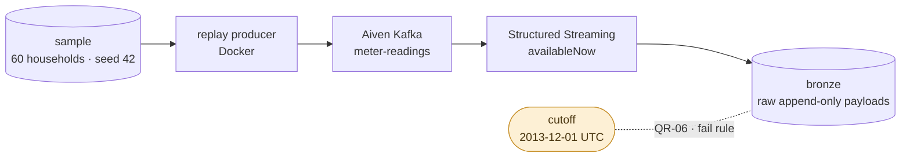
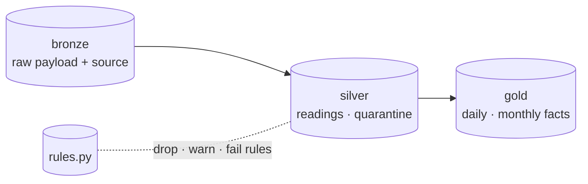
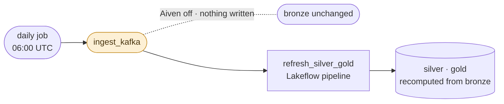

# Smart Meter Peak Prediction

Household-level consumption peak prediction on a Databricks lakehouse, with streaming ingestion and governed ML features

## Problem

Predicting when a household reaches its consumption peak needs clean, complete, point-in-time
correct half-hourly readings. Raw smart meter data arrives from two sources (historical files and a
stream), with malformed timestamps, non-numeric values, gaps, daylight saving artefacts and
duplicates. Without a governed ingestion layer, every model would have to rediscover and re-fix
these problems, and no result could be reproduced.

The first feature, **METER_INGESTION**, provides that layer for a 60-household sample of the London
smart meter data set: Bronze, Silver and Gold tables with data contracts, quality rules with a
quarantine, and per-household data quality facts. The follow-up feature, PEAK_MODEL, reads these
tables to build features and train models.

## Architecture

**The ingestion spine.** Recent readings are a Kafka stream; earlier ones arrive
as files through Auto Loader, and both land in Bronze. The cutoff is marked
because it is the only rule that decides which path owns a reading: a row on the
wrong side of `2013-12-01T00:00:00Z` aborts the update instead of being
quarantined.



**The layers.** Bronze keeps the raw payload and its source, silver checks and
deduplicates it, gold aggregates. Which rows survive is not in the pipeline
code — it is a row in `rules.py`, wired as an expectation.



**What wakes it.** One daily job, and the Kafka task is the only one that leaves
the workspace. It is marked because an Aiven outage stops there: the task fails
within seconds, Bronze and its checkpoint stay as they were, and silver and gold
wait for the next run.



<details>
<summary>Same diagram as plain text</summary>

```
┌───────────────────────┐                        ┌───────────────────────┐
│  Historical files     │                        │  Replay producer      │
│  17 monthly CSVs +    │                        │  (Docker)             │
│  households           │                        │  keyed by household   │
└───────────┬───────────┘                        └───────────┬───────────┘
            │ databricks fs cp                               │
┌───────────▼───────────┐                        ┌───────────▼───────────┐
│  Unity Catalog Volume │                        │  Aiven Kafka          │
│  landing              │                        │  meter-readings       │
└───────────┬───────────┘                        │  2 partitions, SCRAM  │
            │                                    └───────────┬───────────┘
┌───────────▼───────────┐                        ┌───────────▼───────────┐
│  Auto Loader          │                        │  Structured Streaming │
│  availableNow         │                        │  availableNow         │
└───────────┬───────────┘                        └───────────┬───────────┘
            │     files before the cutoff · Kafka after (QR-06)
            └──────────────────────────┬─────────────────────┘
                                       │
┌──────────────────────────────────────▼────────────────────────────────────┐
│  Databricks · Unity Catalog (smart_meter_dev)                             │
│                                                                           │
│   BRONZE ───────────────► SILVER ──────────────────► GOLD                 │
│   3 append-only tables    meter_readings             daily consumption    │
│   raw payload + source    households                 monthly quality      │
│   (the replay source)     quarantine (failed rules)  quality summary view │
│                                                                           │
│   rules.py ── every rule, wired as an expectation ──┘                     │
└───────────────────────────────────────────────────────────────────────────┘
                                       ▲
                                       │ one daily job, serverless
                              ┌────────┴─────────────────────────────────┐
                              │  setup_catalog → ingest_files            │
                              │                → ingest_kafka (Aiven)    │
                              │  → refresh_silver_gold (Lakeflow)        │
                              └──────────────────────────────────────────┘
```

</details>

- **Gold facts, no labels.** Daily consumption per household and a dense household-by-month quality
  table with coverage, zero readings and gaps. Thresholds and labels belong to PEAK_MODEL.
- **Contracts.** Every published table and the Kafka topic has a contract in `docs/contracts/`.
- **Idempotent and UTC.** Re-running with the same input gives the same output; all times are UTC,
  and event time (`reading_ts`) is kept apart from processing time (`_ingested_at`).
- **Deployment.** A Databricks Asset Bundle (`databricks.yml`, `resources/`) deploys the job and the
  pipeline to a `dev` target on Databricks Free Edition.

Specifications: active features in [`.claude/sdd/features/`](.claude/sdd/features); shipped
features (brainstorm, define, design, build report and the ship record) in
[`.claude/sdd/archive/`](.claude/sdd/archive), for example
[`METER_INGESTION`](.claude/sdd/archive/METER_INGESTION). Decisions:
[`docs/adr/`](docs/adr/README.md).

## Getting started

Local development (unit tests run on local Spark and need Java 17):

```bash
python -m venv .venv && source .venv/bin/activate
pip install -e ".[dev]"
pre-commit install
cp .env.example .env   # fill in locally; never commit
pytest
```

Generate the sample (needs the Kaggle raw files in `data/raw`, which git ignores):

```bash
pip install -e ".[sample]"
python scripts/prepare_sample.py build --out data/sample/seed42
```

Deploy, load and verify on Databricks: follow the
[runbook](docs/runbooks/meter_ingestion.md). In short:

```bash
databricks bundle validate -t dev -p dev
databricks bundle deploy -t dev -p dev      # first time: deploy, run setup_catalog, deploy again
databricks bundle run -t dev -p dev smart_meter_ingestion
```

The integration tests target the deployed environment, carry the `integration` marker and are
excluded from the default run and from CI. Some are before/after pairs that need a real operation
in between, so run them per step as listed in the runbook ("Evidence order"):

```bash
pip install -e ".[dev,integration]"
pytest -m integration tests/integration/<file>::<test>
```

## Repository layout

| Path | Content |
|---|---|
| `src/smart_meter_peak_prediction/` | Library: sampling, producer, settings, rule catalog, Bronze, Silver, Gold, metrics (tested) |
| `pipelines/` | Lakeflow pipeline sources (Python wiring, SQL summary view) |
| `notebooks/` | Job notebooks: catalog setup, file ingestion, Kafka ingestion |
| `resources/`, `databricks.yml` | Asset Bundle: job, pipeline, variables, targets |
| `docker/producer/` | Replay producer image |
| `config/` | Sample plan, pinned household selection and reference manifest |
| `tests/` | Unit tests, `tests/local_data` (needs raw data), `tests/integration` (needs a deployed workspace) |
| `docs/contracts/` | Data contracts of the tables and the Kafka topic |
| `docs/runbooks/` | Operations runbook |
| `.claude/sdd/` | Feature specifications (brainstorm, define, design, build) |
| `docs/adr/` | Architecture decision records |
| `docs/profiling/` | Data profiles of the sources |
| `spikes/` | Feasibility checks; not part of the product |

## Design decisions

See [`docs/adr/`](docs/adr/README.md).

## Known limitations & roadmap

- Silver and Gold are recomputed in full on every update. This is fine at about 1.7 M rows; the
  revisit trigger (an update over 15 minutes, or Bronze over 50 M rows) is recorded in ADR 0005.
- The Kafka service is a free tier that powers off when idle, and the pipeline refresh waits for the
  Kafka task. An Aiven outage therefore stalls the refresh of Silver and Gold until the next
  successful run (see the runbook).
- Free Edition limits apply: one active pipeline per type, five concurrent tasks, a daily compute
  quota.
- Only the `dev` target is deployed; `prod` is documented.
- Roadmap: PEAK_MODEL (features, training sets, models), then monitoring of data quality trends.

## License

Released under the MIT License. See [LICENSE](LICENSE).
